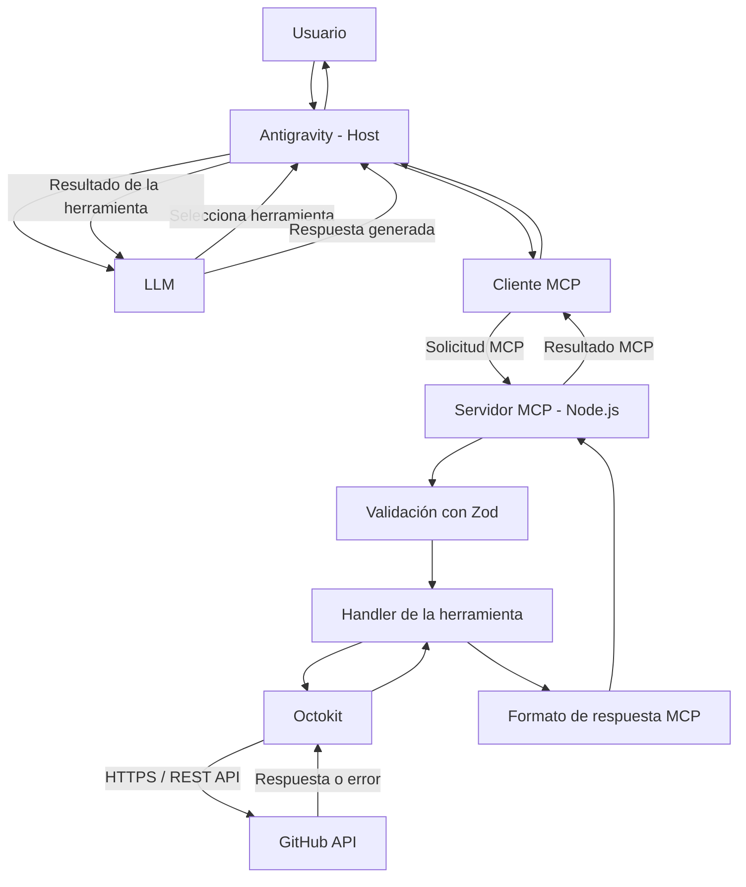

# GitHub MCP Server

**Proyecto Integrador — Módulo 5 | Henry**

Servidor MCP desarrollado con Node.js y TypeScript para interactuar con GitHub mediante asistentes de inteligencia artificial compatibles con Model Context Protocol, como Antigravity.

## 1. Descripción del proyecto

Este proyecto implementa un servidor **MCP (Model Context Protocol)** que permite a un asistente de inteligencia artificial ejecutar operaciones sobre GitHub utilizando herramientas definidas y validadas.

El usuario puede realizar solicitudes en lenguaje natural, como crear un repositorio, consultar issues o agregar archivos mediante commits.

El servidor recibe las solicitudes, valida los parámetros con Zod, utiliza Octokit para comunicarse con la API de GitHub y devuelve respuestas estructuradas al cliente MCP.

### Funcionalidades principales

- Crear repositorios de GitHub.
- Listar repositorios del usuario autenticado.
- Crear issues en repositorios.
- Consultar issues abiertos, cerrados o todos.
- Crear commits para agregar o actualizar archivos.
- Validar parámetros antes de ejecutar operaciones.
- Traducir errores de GitHub a mensajes comprensibles.
- Reintentar determinadas consultas cuando GitHub aplica límites de uso.
- Ejecutar pruebas automatizadas mediante Vitest.

## 2. Tecnologías utilizadas

| Tecnología | Propósito |
|---|---|
| Node.js | Entorno de ejecución del servidor |
| TypeScript | Desarrollo con tipado estático |
| MCP SDK | Implementación del protocolo MCP |
| Octokit | Comunicación con la API de GitHub |
| Zod | Validación de parámetros |
| Vitest | Pruebas automatizadas |
| dotenv | Carga de variables de entorno |
| Git y GitHub | Control de versiones |
| Antigravity | Host para utilizar las herramientas MCP |

## 3. Arquitectura del sistema

El sistema utiliza una arquitectura modular, separando la definición de herramientas, validaciones, lógica de ejecución y comunicación con GitHub.

### Diagrama de arquitectura





### Flujo de una solicitud

1. El usuario escribe una instrucción en lenguaje natural dentro de Antigravity.
2. El asistente identifica qué herramienta MCP necesita utilizar.
3. El cliente MCP envía una solicitud al servidor.
4. El servidor valida los parámetros mediante Zod.
5. El handler correspondiente ejecuta la operación mediante Octokit.
6. Octokit se comunica con la API REST de GitHub utilizando el token configurado.
7. GitHub devuelve el resultado de la operación o un error.
8. El servidor transforma la respuesta y la devuelve al cliente MCP.
9. Antigravity presenta el resultado al usuario.

El servidor utiliza el transporte **stdio**, mediante el cual intercambia mensajes MCP con el cliente a través de la entrada y salida estándar del proceso.

Los mensajes de diagnóstico se escriben en `stderr` para no interferir con la comunicación del protocolo.

## 4. Estructura del proyecto

```text
mcp-server-starter/
├── src/
│   ├── config/
│   │   └── github.ts
│   ├── handlers/
│   │   ├── createRepository.ts
│   │   ├── listRepositories.ts
│   │   ├── createIssue.ts
│   │   ├── listIssues.ts
│   │   └── createCommit.ts
│   ├── schemas/
│   │   └── github.schemas.ts
│   ├── tools/
│   │   └── definitions.ts
│   ├── types/
│   │   └── github.types.ts
│   ├── utils/
│   │   ├── response.ts
│   │   ├── githubError.ts
│   │   └── retry.ts
│   ├── index.ts
│   └── server.ts
├── tests/
│   ├── tools.test.ts
│   ├── github.test.ts
│   ├── errors.test.ts
│   └── retry.test.ts
├── .env.example
├── .gitignore
├── package.json
├── tsconfig.json
└── README.md
```

### Responsabilidad de los módulos

- `index.ts`: punto de entrada del servidor.
- `server.ts`: inicialización y registro de herramientas MCP.
- `config/github.ts`: configuración de Octokit y autenticación.
- `handlers/`: implementación de las operaciones disponibles.
- `schemas/`: validaciones de entrada mediante Zod.
- `tools/definitions.ts`: definición de herramientas MCP.
- `types/`: tipos utilizados para estructurar los datos.
- `utils/response.ts`: formato común de respuestas exitosas y errores.
- `utils/githubError.ts`: identificación y traducción de errores.
- `utils/retry.ts`: reintentos controlados ante límites de la API.
- `tests/`: pruebas automatizadas con Vitest.

## 5. Requisitos previos

Antes de instalar el proyecto, se necesita:

- Node.js y npm instalados.
- Git instalado.
- Una cuenta de GitHub.
- Un Personal Access Token de GitHub.
- Antigravity u otro cliente compatible con MCP.
- Conexión a Internet para utilizar la API de GitHub.

Se recomienda utilizar una versión LTS de Node.js compatible con las dependencias del proyecto.

Para comprobar la instalación:

```bash
node --version
npm --version
git --version
```

Si los comandos muestran sus respectivas versiones, se puede continuar.

## 6. Instalación paso a paso

### 6.1. Clonar el repositorio

Abrir una terminal y ejecutar:

```bash
git clone https://github.com/octaviolanne-hue/ProyectoIntegradorM5.git
```

Ingresar a la carpeta del proyecto:

```bash
cd ProyectoIntegradorM5
```

Si el código fuente se encuentra dentro de la subcarpeta `mcp-server-starter`, ingresar también en ella:

```bash
cd mcp-server-starter
```

Todos los comandos siguientes deben ejecutarse desde la carpeta que contiene `package.json`.

### 6.2. Instalar las dependencias

```bash
npm install
```

Este comando instala las dependencias necesarias para compilar y ejecutar el servidor.

### 6.3. Configurar las variables de entorno

Crear un archivo llamado `.env` en la misma carpeta que `package.json`.

Ejemplo:

```dotenv
GITHUB_TOKEN=tu_token_personal_de_github
```

Reemplazar el valor de ejemplo por un token válido.

**Importante:** el nombre `GITHUB_TOKEN` debe coincidir con el que utiliza `src/config/github.ts`.

El archivo `.env` contiene información sensible y no debe subirse al repositorio.

El archivo `.gitignore` debe incluir:

```gitignore
node_modules/
dist/
.env
.env.*
!.env.example
.DS_Store
*.log
```

Se recomienda mantener un archivo `.env.example` sin credenciales reales:

```dotenv
GITHUB_TOKEN=coloca_tu_token_aqui
```

## 7. Obtener un GitHub Personal Access Token

El servidor necesita un token para autenticarse y realizar operaciones mediante la API de GitHub.

### 7.1. Crear el token

1. Iniciar sesión en GitHub.
2. Abrir **Settings**.
3. Ingresar a **Developer settings**.
4. Seleccionar **Personal access tokens**.
5. Elegir **Tokens (classic)**.
6. Presionar **Generate new token (classic)**.
7. Escribir un nombre descriptivo, por ejemplo `Henry-MCP-Server`.
8. Seleccionar una fecha de vencimiento.
9. Configurar los permisos necesarios.
10. Generar el token y copiarlo.

Acceso directo:

https://github.com/settings/tokens

### 7.2. Permisos necesarios

Para un Personal Access Token clásico, se recomienda configurar:

| Scope | Uso |
|---|---|
| `repo` | Crear y administrar repositorios, archivos, commits e issues, incluidos repositorios privados |
| `public_repo` | Alternativa más limitada cuando se trabaja exclusivamente con repositorios públicos |

**No es necesario seleccionar ambos:** `repo` ya incluye acceso a repositorios públicos.

El scope `repo` concede permisos amplios. Se recomienda utilizar una cuenta de prueba o un token dedicado al proyecto, con vencimiento definido.

También existen tokens *fine-grained*, que permiten restringir repositorios y permisos de manera más específica. Su configuración es diferente y requiere seleccionar permisos como **Contents** e **Issues**. Para reproducir la configuración documentada aquí se utiliza un token clásico.

### 7.3. Guardar el token

Dentro de `.env`:

```dotenv
GITHUB_TOKEN=github_pat_o_token_correspondiente
```

No agregar comillas ni espacios innecesarios.

Nunca compartir el token en capturas de pantalla, documentación, commits o mensajes públicos.

Si un token se publica accidentalmente, debe revocarse y reemplazarse.

## 8. Compilar y ejecutar el servidor

### 8.1. Compilar TypeScript

Desde la carpeta del proyecto:

```bash
npm run build
```

La compilación genera los archivos JavaScript dentro de `dist/`.

### 8.2. Ejecutar el servidor

```bash
node dist/index.js
```

El servidor utiliza stdio y queda disponible para recibir solicitudes de un cliente MCP.

**Nota:** es normal que no aparezca una interfaz visual. El servidor está diseñado para comunicarse con un cliente MCP, no para funcionar como una aplicación web tradicional.

Para detenerlo desde la terminal, utilizar `Ctrl + C`.

## 9. Configuración en Antigravity

Para utilizar el servidor desde Antigravity, es necesario registrarlo como un servidor MCP local.

### 9.1. Localizar la configuración MCP

Abrir Antigravity y acceder a la sección de configuración de servidores MCP.

Seleccionar la opción para agregar un servidor personalizado o editar su configuración.

La ubicación exacta de esta opción puede variar según la versión instalada.

### 9.2. Agregar el servidor

Ejemplo de configuración:

```json
{
  "mcpServers": {
    "github-mcp": {
      "command": "node",
      "args": [
        "/RUTA_ABSOLUTA/ProyectoIntegradorM5/dist/index.js"
      ],
      "cwd": "/RUTA_ABSOLUTA/ProyectoIntegradorM5"
    }
  }
}
```

Reemplazar `/RUTA_ABSOLUTA/ProyectoIntegradorM5` por la ruta real de la carpeta que contiene `package.json`.

Si el proyecto se encuentra dentro de `mcp-server-starter`, utilizar esa carpeta en `cwd` y en la ruta de `dist/index.js`.

Por ejemplo, en macOS:

```json
{
  "mcpServers": {
    "github-mcp": {
      "command": "node",
      "args": [
        "/Users/usuario/proyectos/mcp-server-starter/dist/index.js"
      ],
      "cwd": "/Users/usuario/proyectos/mcp-server-starter"
    }
  }
}
```

Esta configuración supone que `config/github.ts` carga el archivo `.env` desde el directorio de trabajo.

También se puede configurar el token mediante el campo `env`, si el cliente lo admite. No se recomienda guardar tokens reales en archivos de configuración que vayan a compartirse.

### 9.3. Activar el servidor

1. Guardar la configuración MCP.
2. Reiniciar o recargar los servidores MCP de Antigravity.
3. Verificar que `github-mcp` figure como conectado.
4. Comprobar que aparezcan las cinco herramientas disponibles.

### 9.4. Verificar la conexión

Enviar al asistente este prompt:

> Utilizá la herramienta `list_repositories` de mi servidor MCP de GitHub para mostrar mis repositorios. Indicá el nombre completo, descripción y URL de cada uno.

Si el servidor está correctamente configurado, Antigravity debería ejecutar la herramienta y mostrar la información obtenida desde GitHub.

## 10. Documentación de las herramientas MCP

El servidor implementa cinco herramientas. Cada una recibe parámetros validados mediante Zod y devuelve una respuesta estructurada.

### 10.1. `create_repository`

**Descripción:** crea un nuevo repositorio en la cuenta de GitHub autenticada.

**Parámetros:**

| Parámetro | Tipo | Descripción |
|---|---|---|
| `name` | string | Nombre del repositorio |
| `description` | string | Descripción del repositorio |
| `private` | boolean | Indica si el repositorio será privado |

**Ejemplo de argumentos:**

```json
{
  "name": "mi-proyecto-mcp",
  "description": "Repositorio creado mediante MCP",
  "private": false
}
```

**Prompt recomendado:**

> Utilizá `create_repository` para crear en mi cuenta de GitHub un repositorio público llamado `mi-proyecto-mcp`, con la descripción `Repositorio creado mediante MCP`. Mostrame su URL cuando termine.

**Resultado esperado:** nombre completo, URL, visibilidad y descripción del repositorio creado.

**Posibles errores:** nombre inválido, repositorio existente, credenciales incorrectas o permisos insuficientes.

### 10.2. `list_repositories`

**Descripción:** consulta los repositorios accesibles mediante la cuenta autenticada, utilizando los parámetros admitidos por el esquema de la herramienta.

**Parámetros:** los definidos en `listRepositoriesSchema`, con sus valores predeterminados cuando corresponda.

**Ejemplo de argumentos:**

```json
{
  "type": "public",
  "sort": "updated",
  "per_page": 10
}
```

**Prompt recomendado:**

> Utilizá `list_repositories` para consultar mis repositorios de GitHub. Mostrá el nombre completo, descripción, visibilidad y enlace de cada uno.

**Resultado esperado:** lista de repositorios con los campos:

- `full_name`
- `html_url`
- `private`
- `description`
- `owner.login`

**Posibles errores:** token inválido, falta de permisos o límites de la API.

### 10.3. `create_issue`

**Descripción:** crea un issue dentro de un repositorio existente.

**Parámetros:**

| Parámetro | Tipo | Descripción |
|---|---|---|
| `owner` | string | Usuario u organización propietaria |
| `repo` | string | Nombre del repositorio |
| `title` | string | Título del issue |
| `body` | string | Descripción del issue |

**Ejemplo de argumentos:**

```json
{
  "owner": "octaviolanne-hue",
  "repo": "ProyectoIntegradorM5",
  "title": "Mejorar la documentación",
  "body": "Agregar instrucciones de instalación y ejemplos de uso."
}
```

**Prompt recomendado:**

> Utilizá `create_issue` para crear un issue en el repositorio `octaviolanne-hue/ProyectoIntegradorM5`, con título `Mejorar la documentación` y descripción `Agregar instrucciones de instalación y ejemplos de uso`. Mostrame el número y el enlace del issue creado.

**Resultado esperado:** número, título, estado y URL del issue.

**Posibles errores:** repositorio inexistente, credenciales inválidas, permisos insuficientes o datos rechazados por GitHub.

### 10.4. `list_issues`

**Descripción:** obtiene los issues de un repositorio de GitHub y permite filtrarlos por estado.

**Parámetros:**

| Parámetro | Tipo | Descripción |
|---|---|---|
| `owner` | string | Propietario del repositorio |
| `repo` | string | Nombre del repositorio |
| `state` | string | `open`, `closed` o `all`; por defecto `open` |

**Ejemplo de argumentos:**

```json
{
  "owner": "octaviolanne-hue",
  "repo": "ProyectoIntegradorM5",
  "state": "open"
}
```

**Prompt recomendado:**

> Utilizá `list_issues` para consultar los issues abiertos del repositorio `octaviolanne-hue/ProyectoIntegradorM5`. Mostrá el número, título, autor y enlace de cada issue.

**Resultado esperado:** lista de issues con número, título, estado, autor, descripción, URL y fecha de creación.

**Posibles errores:** repositorio inexistente, credenciales inválidas, permisos insuficientes o límites de la API.

### 10.5. `create_commit`

**Descripción:** agrega o actualiza un archivo dentro de un repositorio mediante un commit en la rama predeterminada.

**Parámetros:**

| Parámetro | Tipo | Descripción |
|---|---|---|
| `owner` | string | Propietario del repositorio |
| `repo` | string | Nombre del repositorio |
| `path` | string | Ruta del archivo |
| `content` | string | Contenido del archivo |
| `message` | string | Mensaje del commit |

**Ejemplo de argumentos:**

```json
{
  "owner": "octaviolanne-hue",
  "repo": "ProyectoIntegradorM5",
  "path": "ejemplo.txt",
  "content": "Archivo creado desde un servidor MCP.",
  "message": "docs: agregar archivo de ejemplo"
}
```

**Prompt recomendado:**

> Utilizá `create_commit` en el repositorio `octaviolanne-hue/ProyectoIntegradorM5` para crear el archivo `ejemplo.txt` con el contenido `Archivo creado desde un servidor MCP.`. Usá el mensaje de commit `docs: agregar archivo de ejemplo` y mostrame el enlace al commit.

**Resultado esperado:** propietario, repositorio, rama, ruta del archivo, SHA del commit, mensaje y URL del commit.

**Funcionamiento interno:**

1. Consulta el repositorio y su rama predeterminada.
2. Obtiene la referencia de la rama.
3. Consulta el commit actual.
4. Crea un blob con el contenido del archivo.
5. Construye un nuevo árbol de archivos.
6. Crea un commit con el nuevo árbol.
7. Actualiza la referencia de la rama.

La actualización se realiza sin forzar la referencia (`force: false`).

**Posibles errores:** repositorio inexistente, ruta inválida, falta de permisos, conflictos de referencia o errores de la API.

## 11. Formato de respuestas

Las herramientas utilizan una estructura común para indicar si una operación se completó correctamente.

### Respuesta exitosa

Ejemplo ilustrativo:

```json
{
  "ok": true,
  "data": {
    "full_name": "usuario/repositorio",
    "html_url": "https://github.com/usuario/repositorio"
  }
}
```

### Respuesta con error

```json
{
  "ok": false,
  "error": {
    "code": "AUTHENTICATION_ERROR",
    "message": "Las credenciales de GitHub no son válidas. Verificá tu token de acceso."
  }
}
```

Entre los códigos utilizados se encuentran:

- `VALIDATION_ERROR`
- `AUTHENTICATION_ERROR`
- `GITHUB_API_ERROR`
- `REPOSITORY_NOT_FOUND`
- `REPOSITORY_ALREADY_EXISTS`

Las respuestas se transportan mediante el formato de resultados de herramientas MCP.

## 12. Manejo de errores y rate limits

El servidor incorpora funciones reutilizables para identificar y traducir errores de GitHub.

### Validación de entrada

Los argumentos se validan mediante esquemas Zod antes de ejecutar solicitudes a la API.

Cuando los datos son inválidos, el servidor devuelve un error de validación.

### Traducción de errores

El módulo `githubError.ts` identifica códigos HTTP y devuelve mensajes comprensibles.

Por ejemplo:

| HTTP | Interpretación |
|---|---|
| `401` | Credenciales inválidas |
| `403` | Permisos insuficientes o límite de uso |
| `404` | Recurso inexistente o inaccesible |
| `422` | Datos rechazados por GitHub |
| `429` | Demasiadas solicitudes |

Algunas herramientas conservan tratamientos específicos para determinados errores.

### Reintentos automáticos

El módulo `retry.ts` implementa reintentos controlados mediante `withRetry()`.

Características:

- Máximo de tres intentos por defecto.
- Detección de errores por rate limit.
- Espera progresiva cuando no existen indicaciones específicas.
- Interpretación de `Retry-After`.
- Interpretación de `x-ratelimit-reset`.
- Detección del límite principal agotado mediante `x-ratelimit-remaining`.
- No reintenta errores comunes de permisos.

Los reintentos están integrados en las operaciones de lectura.

Las operaciones de escritura no se reintentan automáticamente para reducir el riesgo de duplicaciones o cambios inconsistentes cuando se pierde una respuesta.

## 13. Pruebas automatizadas

El proyecto utiliza **Vitest** para comprobar el comportamiento de validaciones, handlers y utilidades.

### Ejecutar los tests

```bash
npm test
```

### Cobertura funcional de las pruebas

Se incluyen pruebas de:

- Parámetros válidos e inválidos con Zod.
- Transformación de respuestas de GitHub.
- Simulación de operaciones mediante mocks de Octokit.
- Errores HTTP 401, 403 y 404.
- Traducción de errores a mensajes comprensibles.
- Detección de límites de la API.
- Reintentos de operaciones.
- Ausencia de reintentos ante errores de permisos.
- Límite máximo de intentos.
- Cálculo de esperas con `Retry-After`.
- Cálculo de esperas con `x-ratelimit-reset`.

**Resultado de la última ejecución durante el desarrollo: 26 tests aprobados.**

### ¿Qué es un mock?

Un mock es una función simulada que reemplaza temporalmente una dependencia externa durante una prueba.

En este proyecto se utilizan mocks de Octokit para simular respuestas de GitHub sin realizar solicitudes reales.

Esto permite probar el comportamiento del servidor sin consumir límites de la API, crear recursos innecesarios ni depender de un token real.

Las pruebas unitarias complementan las verificaciones de integración realizadas desde Antigravity.

## 14. Verificación completa del funcionamiento

Después de instalar y configurar el servidor, se recomienda realizar las siguientes verificaciones en un repositorio de prueba.

### Verificación 1: conexión

Solicitar a Antigravity que ejecute `list_repositories`.

**Resultado esperado:** devuelve los repositorios del usuario autenticado.

### Verificación 2: creación de repositorio

Solicitar la creación de un repositorio público de prueba.

**Resultado esperado:** GitHub crea el repositorio y el servidor devuelve su URL.

### Verificación 3: creación de issue

Solicitar la creación de un issue dentro del repositorio de prueba.

**Resultado esperado:** el servidor devuelve el número y enlace del issue.

### Verificación 4: consulta de issues

Solicitar los issues abiertos del repositorio.

**Resultado esperado:** aparece el issue creado anteriormente.

### Verificación 5: creación de commit

Solicitar la creación de un archivo de texto mediante `create_commit`.

**Resultado esperado:** el archivo aparece en GitHub y el servidor devuelve el enlace al commit.

Estas verificaciones permiten comprobar la integración entre Antigravity, el servidor MCP y GitHub.

## 15. Troubleshooting — Problemas frecuentes

### Error: `GITHUB_TOKEN` no configurado

**Posible causa:** falta el archivo `.env`, la variable tiene otro nombre o no se está cargando correctamente.

**Solución:**

- Verificar que `.env` exista.
- Confirmar que la variable coincida con la utilizada en `config/github.ts`.
- Comprobar el directorio de trabajo del servidor.
- Reiniciar Antigravity después de corregir la configuración.

### Error: `AUTHENTICATION_ERROR`

**Posible causa:** el token es inválido, fue revocado o expiró.

**Solución:**

- Generar un token nuevo.
- Comprobar que se haya copiado correctamente.
- Actualizar `.env`.
- Reiniciar el servidor MCP.

### Error: `403 Forbidden`

**Posible causa:** permisos insuficientes o límite de uso de GitHub.

**Solución:**

- Revisar los permisos del token.
- Verificar que la cuenta tenga acceso al repositorio.
- Consultar los límites de uso de GitHub.
- Esperar al restablecimiento del límite cuando corresponda.

### Error: `404 Not Found`

**Posible causa:** el repositorio no existe, el nombre es incorrecto o la cuenta no tiene acceso.

**Solución:**

- Verificar los parámetros `owner` y `repo`.
- Comprobar que el repositorio exista.
- Confirmar que el token permita acceder a él.

### Error: `422 Unprocessable Entity`

**Posible causa:** GitHub rechazó los datos de la operación.

**Solución:**

- Revisar los parámetros enviados.
- Comprobar si ya existe un repositorio con ese nombre.
- Validar las restricciones de la operación solicitada.

### Error: `Cannot find module .../dist/index.js`

**Posible causa:** el proyecto no fue compilado o la ruta configurada es incorrecta.

**Solución:**

```bash
npm run build
```

Después, comprobar que exista `dist/index.js` y corregir la ruta en Antigravity si es necesario.

### Antigravity no muestra las herramientas MCP

**Posibles causas:** configuración incorrecta, ruta inválida o error al iniciar el servidor.

**Solución:**

1. Revisar la configuración MCP.
2. Confirmar que Node.js esté instalado.
3. Verificar la ruta absoluta de `dist/index.js`.
4. Comprobar el directorio de trabajo.
5. Revisar los logs del cliente.
6. Reiniciar o recargar el servidor MCP.

### El servidor no muestra nada al ejecutarse

Esto puede ser normal.

El servidor utiliza stdio y espera solicitudes de un cliente MCP. No presenta una interfaz gráfica ni una página web.

Para utilizarlo, conectarlo a Antigravity u otro cliente MCP compatible.

### Los tests fallan

Ejecutar:

```bash
npm install
npm run build
npm test
```

Si un test falla, revisar el mensaje de Vitest, el archivo indicado y los cambios realizados recientemente.

## 16. Seguridad y buenas prácticas

El proyecto aplica las siguientes medidas:

- Las credenciales se cargan desde variables de entorno.
- El token de GitHub no se incluye en el código fuente.
- `.env` está excluido del control de versiones.
- Los parámetros se validan con Zod.
- Los errores se transforman en respuestas comprensibles.
- Los logs de errores evitan imprimir objetos completos que podrían contener información sensible.
- Los reintentos se limitan para evitar solicitudes indefinidas.
- Las operaciones de escritura no se repiten automáticamente.
- Se recomienda utilizar repositorios de prueba durante las verificaciones.

## 17. Limitaciones conocidas

- El servidor depende de la disponibilidad de la API de GitHub.
- Las operaciones requieren permisos adecuados en el token.
- `list_issues` consulta hasta 100 resultados por solicitud; no implementa paginación completa.
- Los reintentos automáticos están orientados a las operaciones de lectura.
- Los límites de uso de GitHub pueden requerir esperas prolongadas.
- La creación de commits utiliza la rama predeterminada del repositorio.
- Las pruebas automatizadas no reemplazan las pruebas de integración reales.

## 18. Repositorio

Código fuente disponible en:

https://github.com/octaviolanne-hue/ProyectoIntegradorM5

## 19. Autor

**Octavio Lanne**

Proyecto desarrollado como trabajo integrador del Módulo 5 de Henry, aplicando conceptos de integración de APIs, TypeScript, Model Context Protocol, validación de datos, manejo de errores y pruebas automatizadas.